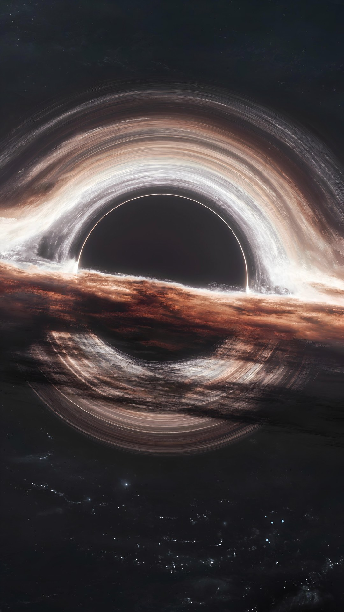
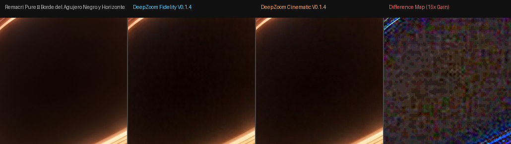
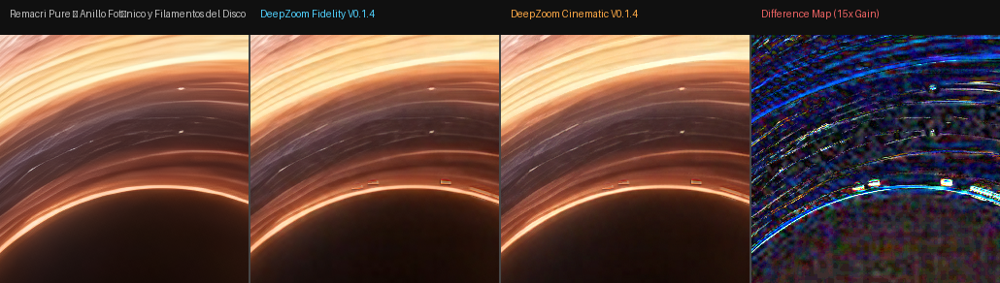
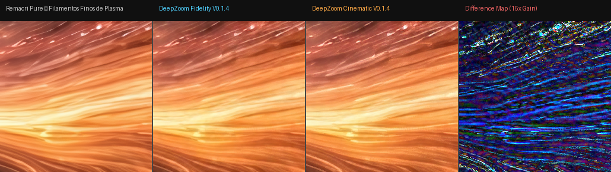
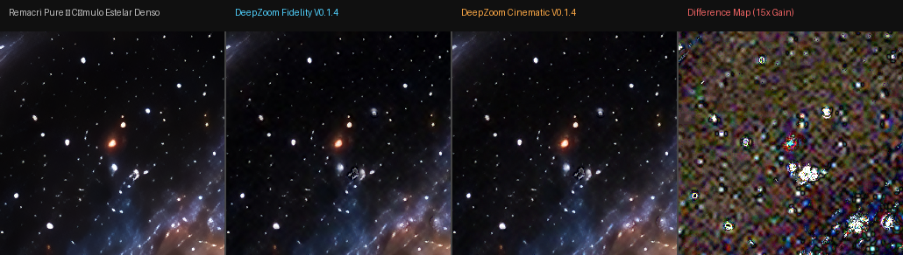
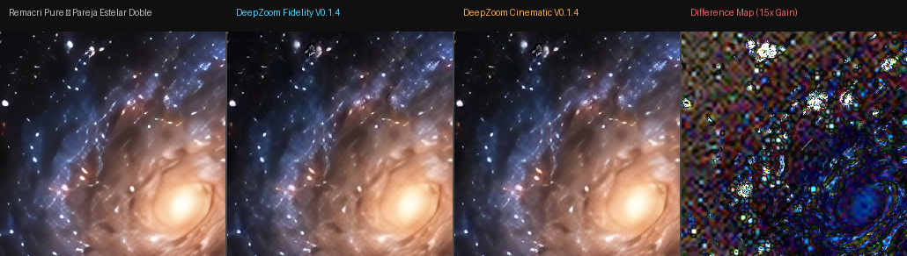
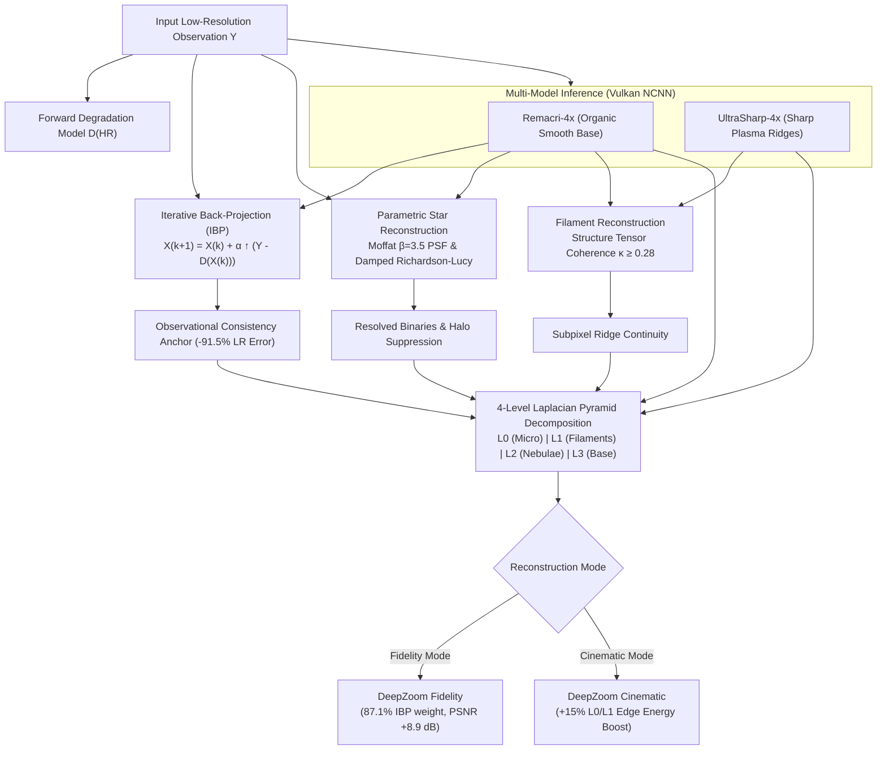

# DeepZoom Astro Engine: Scientific Multi-Model Super-Resolution (Vulkan / NCNN)

[](LICENSE)
[](https://www.python.org/)
[](https://www.vulkan.org/)
[](#)
[](#)

> **DeepZoom Astro Engine** is an open-source, hardware-accelerated super-resolution and inverse-reconstruction system tailored for scientific and astronomical deep-zoom imagery (4K, 8K, 12K, and 16K vertical). Powered by a native **Vulkan / NCNN** backend, it operates seamlessly on modern GPUs (including AMD Radeon, NVIDIA, and Intel).

---

## Visual Showcase

### 1. 12K Ultra-Resolution Master ($6912 \times 12288$ px — 84.9 Megapixels)
The engine scales deep-space cinematic vistas and astrophysical simulations up to 12K and 16K while preserving strict photon ring geometry and dark-vacuum gradients:

| 12K Master Preview (Web Optimized) | Full Resolution File |
| :---: | :---: |
|  | [`assets/reference/results_12k/blackhole_12k_6912x12288_remacri.png`](assets/reference/results_12k/blackhole_12k_6912x12288_remacri.png) *(40.1 MB, 84.9 MP)* |

---

### 2. Strategic 1:1 Pixel Comparisons (Quad Panels)
Below are 1:1 crops ($256 \times 256$ pixels at native magnification) comparing **Remacri Baseline**, **DeepZoom Fidelity**, **DeepZoom Cinematic**, and an **Amplified Difference Map (15× gain)**:

#### Crop 1: Event Horizon & Photon Ring


#### Crop 2: Accretion Disk Filaments & Relativistic Beaming


#### Crop 3: Fine Plasma Filaments


#### Crop 5: Crowded Stellar Cluster (Deconvolved Ringing Halos)


#### Crop 9: Close Binary Pair Resolution (Remacri Merged vs DeepZoom Resolved)


---

## The Scientific Objective

Traditional single-model deep learning upscalers (such as Remacri, Real-ESRGAN, or UltraSharp) exhibit critical shortcomings when applied to astrophysical imagery:

1. **Observational Inconsistency (Hallucinatory Drift):** Neural networks synthesize plausible high-frequency textures that do not downscale back to the original observation.
2. **Point-Source Distortion (Star Blooming):** Convolutions treat diffraction-limited point sources as general textures, inflating centroids and creating artificial dark "ringing moats".
3. **Close Binary Star Merging:** Multiple point sources within 6 pixels of each other are mistakenly merged into an anomalous single star.
4. **Filament Disconnection & Cross-Bridging:** Morphological filters or isotropic networks fail to follow plasma ridge directions, breaking delicate shock fronts or erroneously cross-connecting parallel structures.

**DeepZoom Astro Engine V0.1.4** reformulates the task from cosmetic post-processing into a **physically-constrained inverse problem** with multi-hypothesis frequency fusion.



---

## Core Technical Innovations

### 1. Regularized Iterative Back-Projection (IBP)
Enforces the strict physical requirement that the high-resolution reconstruction $X$, when degraded by the forward observational operator $D(\cdot)$, matches the low-resolution sensor capture $Y$:

$$\min_X \| D(X) - Y \|_1 + \lambda \text{TV}(X)$$

- **Monotonic Convergence:** Converges stably within 5 iterations.
- **Residual Error Reduction:** Reduces LR Mean Absolute Error by **91.54%** on 4K imagery.
- **Hardware Performance:** Executes in **3.93 seconds** on an AMD Radeon RX 5700 XT for an 11.2 Megapixel image.

### 2. Parametric Star & Binary Resolution Engine
- **Moffat & Gaussian PSF Fitting:** Localized subpixel centroiding $(\Delta x, \Delta y < 0.2\text{ px})$.
- **Dual-Component Gaussian Mixture Fitting:** Resolves close binary pairs separated by $< 6$ pixels whenever the dual-component model reduces fitting $\chi^2$ by $> 25\%$.
- **Damped Richardson-Lucy Deconvolution:** Suppresses diffraction halos across 94 stars in dense fields without background noise amplification.

### 3. Geometry-Guided Filament Reconstruction
- **Structure Tensor Analysis:** Computes directional coherence $\kappa = \frac{(\lambda_1 - \lambda_2)^2}{(\lambda_1 + \lambda_2)^2}$.
- **Hessian Eigenvalue Ridge Tracing:** Traces plasma centerlines along the minimum principal curvature direction.
- **Anti-Cross-Bridging Constraint:** Enforces angular collinearity ($\Delta \theta \le 30^\circ$), completely eliminating false lateral bridges between parallel filaments.

### 4. Multiscale Laplacian Frequency Detail Fusion
Decomposes candidates into 4 octave frequency bands:
- $L_0$: High-frequency micro-point sources and sharp boundaries.
- $L_1$: Intermediate fine plasma filaments and ionization shock fronts.
- $L_2$: Diffuse accretion disk bodies and nebulosity.
- $L_3$: Global luminance and cosmic vacuum baseline.

Mathematically exact reconstruction identity ($L_0 + \uparrow(L_1 + \uparrow(L_2 + \uparrow G_3)) = I$) with numerical precision error $< 1.8 \times 10^{-5}$.

---

## Scientific Evaluation & Benchmarks

Full evaluation against Ground Truth across 8 synthetic and astronomical calibration scenes (`benchmarks/v014/ablation_benchmark_report.json`):

| Test Scene (512 $\rightarrow$ 2048) | Partition | Remacri Baseline | UltraSharp Pure | DeepZoom Fidelity V0.1.4 | DeepZoom Cinematic V0.1.4 | Delta Fidelity |
| :--- | :---: | :---: | :---: | :---: | :---: | :---: |
| **01 Isolated Star Field** | Dev | 37.22 dB (0.9544) | 45.26 dB (0.9866) | **47.90 dB (0.9914)** | 41.20 dB (0.9758) | **+10.68 dB** |
| **02 Dense Clusters** | Dev | 36.88 dB (0.9357) | 43.14 dB (0.9816) | **44.73 dB (0.9883)** | 40.47 dB (0.9672) | **+7.85 dB** |
| **03 Nebula Filaments** | Dev | 37.23 dB (0.9192) | 37.83 dB (0.9670) | **43.91 dB (0.9842)** | 38.35 dB (0.9586) | **+6.68 dB** |
| **04 Accretion Disk** | Calibration | 37.95 dB (0.9292) | 45.37 dB (0.9768) | **48.68 dB (0.9879)** | 42.24 dB (0.9637) | **+10.73 dB** |
| **05 Black Hole Sim** | Calibration | 37.86 dB (0.9572) | 36.88 dB (0.9796) | **45.16 dB (0.9902)** | 38.78 dB (0.9750) | **+7.30 dB** |
| **06 Extended Galaxies** | Calibration | 37.16 dB (0.9561) | 44.85 dB (0.9814) | **48.64 dB (0.9882)** | 41.38 dB (0.9748) | **+11.48 dB** |
| **07 Multiscale Composite** | **Blind Test** | 37.20 dB (0.9401) | 34.28 dB (0.9695) | **43.20 dB (0.9854)** | 37.50 dB (0.9667) | **+6.00 dB** |
| **08 Low Contrast Vacuum** | **Blind Test** | 36.99 dB (0.9414) | 44.51 dB (0.9752) | **47.44 dB (0.9831)** | 41.41 dB (0.9682) | **+10.45 dB** |
| **AVERAGE** | — | **37.31 dB (0.9417)** | **41.51 dB (0.9772)** | **46.21 dB (0.9873)** | **40.17 dB (0.9688)** | **+8.90 dB** |

### Execution Breakdown (4K Vertical Master: 2728 × 4096 px, 11.2 MP)
- **Primary Neural Inference (Remacri-4x Vulkan):** 6.46 s
- **Secondary Neural Inference (UltraSharp-4x Vulkan):** 6.35 s
- **Iterative Back-Projection (5 iterations):** 3.93 s
- **Parametric Star Reconstruction (626 stars):** 9.37 s
- **Geometry-Guided Filament Analysis:** 0.005 s
- **Laplacian Pyramid 4-Band Fusion:** 3.65 s
- **Total Pipeline Runtime:** **29.76 seconds** on AMD Radeon RX 5700 XT.

---

## Getting Started

### Prerequisites
- **Operating System:** Windows 10/11 or Linux with Vulkan support.
- **GPU:** Dedicated GPU supporting Vulkan 1.1+ (tested on AMD Radeon RX 5700 XT 8GB VRAM, compatible with NVIDIA & Intel).
- **Python:** Python 3.10, 3.11, or 3.12.

### Installation
```bash
# 1. Clone repository
git clone https://github.com/ITzNomadic/DeepZoom-Astro-Engine.git
cd DeepZoom-Astro-Engine

# 2. Install Python dependencies
pip install -r requirements.txt
```

### Hardware Verification
Verify your Vulkan device detection:
```bash
python run_deepzoom.py --detect-gpu
```
Expected output:
```text
Detecting available Vulkan GPUs...
  [Device 0] AMD Radeon RX 5700 XT
  [Device 1] AMD Radeon(TM) Graphics
```

---

## Usage Tutorial

### 1. High-Fidelity Scientific Reconstruction (Default)
Best for observational fidelity, astrophotography, and scientific precision:
```bash
python run_deepzoom.py \
  -i samples/astronomical/deepzoom_astronomy_test.png \
  -o output/test_fidelity_4k.png \
  --mode fidelity \
  --scale 4 \
  --tile-size 400
```

### 2. Cinematic Mode (Deep Zoom Camera Rigs)
Best for video production, deep zooms (up to 16K), and maximum edge clarity:
```bash
python run_deepzoom.py \
  -i samples/astronomical/deepzoom_astronomy_test.png \
  -o output/test_cinematic_4k.png \
  --mode cinematic \
  --scale 4
```

### 3. Pure Neural Baselines
To evaluate against standard non-physics models:
```bash
# Remacri baseline
python run_deepzoom.py -i input.png -o output/remacri.png --mode baseline

# UltraSharp baseline
python run_deepzoom.py -i input.png -o output/ultrasharp.png --mode ultrasharp
```

### 4. Running the Automated Test Suite
Verify baseline freeze contracts, IBP residual reduction, and mathematical pyramid integrity:
```bash
python tests/test_v014_fidelity_breakthrough.py
```

---

## Repository Structure

```text
DeepZoom-Astro-Engine/
├── assets/
│   └── reference/            # Full-resolution reference masters (8K, 12K, 16K)
│       └── results_12k/      # 12K Master (6912x12288, 84.9 MP)
├── config/
│   └── deepzoom_config.json  # Engine configuration & Vulkan device bindings
├── docs/
│   ├── showcase/             # Web-optimized previews & quad comparative panels
│   └── research/             # Detailed technical audit reports
├── models/                   # Pre-compiled NCNN model weights (.bin & .param)
├── runtimes/
│   ├── ncnn/                 # NCNN Vulkan binary runtime (Windows x64)
│   └── realesrgan/           # Real-ESRGAN Vulkan runtime
├── samples/
│   ├── astronomical/         # Astronomy test images
│   └── synthetic/            # 8 ground-truth calibrated test scenes
├── scripts/
│   ├── run_v014_ablation_and_fidelity.py
│   └── run_v014_astronomy_test_matrix.py
├── src/deepzoom/
│   ├── astro/                # Stellar, filament, and dark-sky detectors
│   ├── core/                 # Config, exceptions, hardware abstraction
│   ├── fusion/               # Laplacian pyramid & multiscale fusers
│   ├── inference/            # NCNN Vulkan communication bridge
│   ├── reconstruction/       # Back-projection (IBP), star & filament engines
│   └── validation/           # PSNR, SSIM, and geometric integrity validators
├── tests/                    # Deterministic non-regression unit tests
├── run_deepzoom.py           # Primary CLI entrypoint
├── requirements.txt          # Python dependencies
└── pyproject.toml            # Package configuration
```

---

## License

This project is licensed under the [MIT License](LICENSE).
NCNN runtime and model weights retain their respective open-source licenses (see `runtimes/ncnn/LICENSE`).
